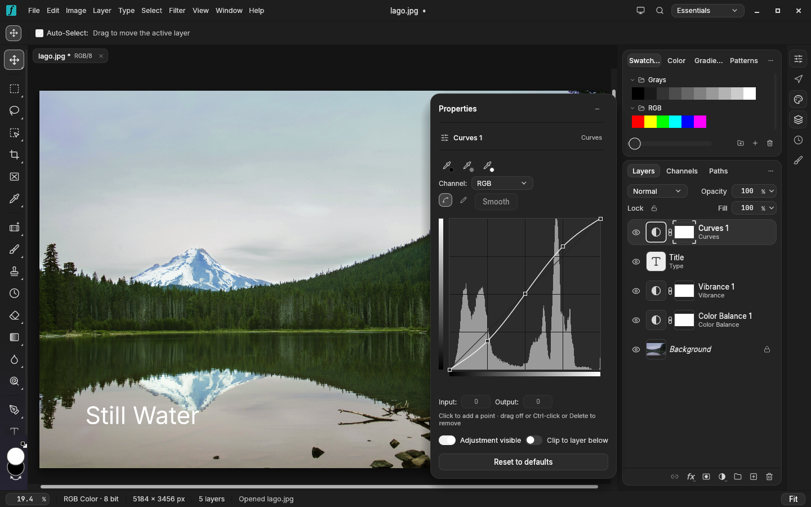
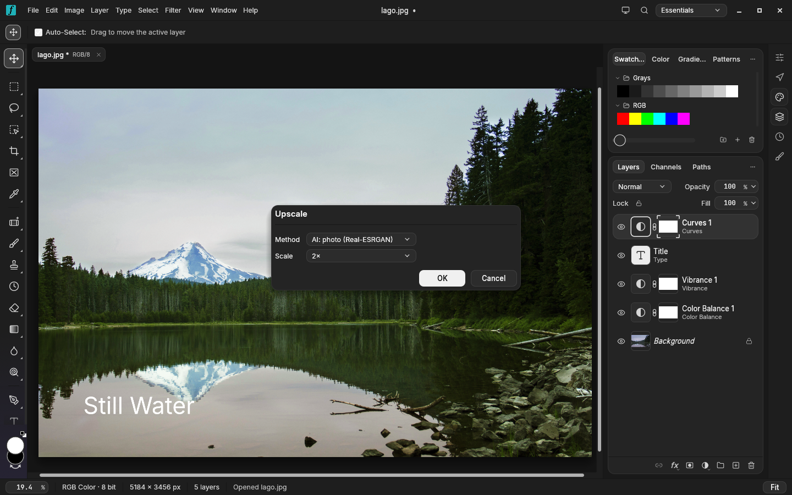
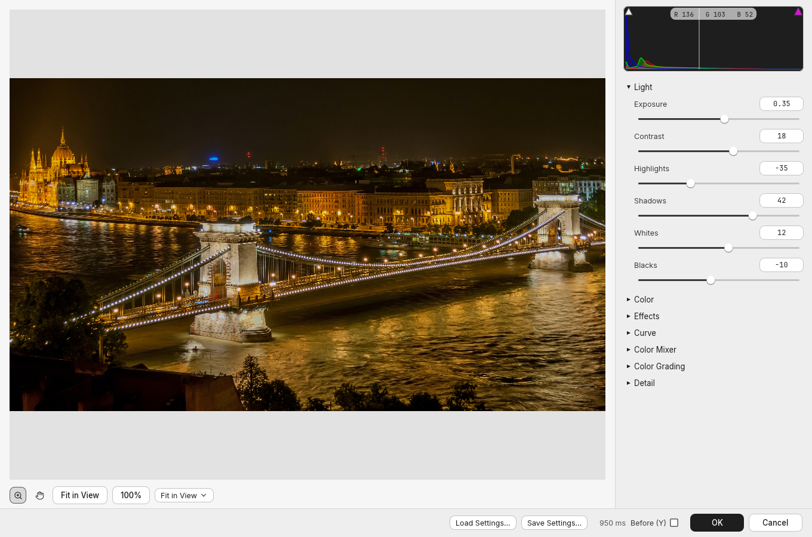

# Fotry

**A native image editor for Linux, drawn on the GPU.** Layers, masks, adjustment layers, live type, camera RAW,
real PSD files and AI upscale, in one fast Rust app. Fotry is the image editor of the
[Arch Quilly](https://github.com/Sapyst/quilly) suite.



## What it does

- **Layers:** groups, masks and vector masks, clipping, blend modes, layer styles (`fx`), smart objects and layer comps.
- **Non-destructive adjustments:** Curves, Levels, Hue/Saturation, Color Balance, Vibrance, Exposure, Black & White,
  Gradient Map, Selective Color, Color Lookup and more, each editable later in Properties.
- **Camera RAW:** develop CR2/CR3, NEF, ARW, DNG, RAF, ORF, RW2 and other raw files with Light, Color, Effects, Curve,
  Color Mixer, Color Grading and Detail. The same editor works as a filter on any layer.
- **Image › Upscale…** (`Ctrl+Alt+U`): 2×, 3× or 4× of the whole document as one undo step. Choose Lanczos,
  Preserve Details, or AI (Real-ESRGAN on the GPU through Vulkan, downloaded the first time you use it).
- **Painting and retouching:** brushes with pressure and `.abr` import, clone and healing tools, content-aware move,
  gradients, liquify and puppet warp.
- **Type and vectors:** live, editable type layers, shapes and paths with the pen tools.
- **Files:** opens and saves real PSD files with their layers. Also PNG, JPEG, WebP, GIF, BMP, TIFF, AVIF, TGA, OpenEXR,
  OpenRaster, Krita, and its own layered `.pcraft` format.
- **The Aero look:** Aero Dark and Aero Light, the Arch Aero desktop's greys and accent colour, following the
  system's light or dark setting.

| Upscale with AI | Camera RAW, in Aero Light |
|---|---|
|  |  |

## Install

On Arch Linux, install the suite's package from the [Arch Quilly releases](https://github.com/Sapyst/quilly/releases).
That is `arch-fotry` on its own, or the whole suite with `arch-quilly`. The Quilly hub keeps it up to date.

```sh
sudo pacman -U arch-fotry-*.pkg.tar.zst
```

To build it from source:

```sh
git clone https://github.com/storytold/craft-fonts ../craft-fonts
CRAFT_FONTS_DIR="$PWD/../craft-fonts" cargo build --release -p photocraft
```

The binary is `target/release/photocraft`. It needs Vulkan (or OpenGL as a fallback) and GTK3 for the file dialogs.

## Based on PhotoCraft

Fotry is a fork of **[PhotoCraft](https://github.com/storytold/photocraft) by the ArtCraft team**
(MIT OR Apache-2.0), which provides the engine and almost everything above. Fotry adds:

- the **Aero** themes (`crates/ui-egui/src/aero.rs`);
- **Image › Upscale…** (`crates/engine/src/upscale_cmds.rs`);
- the suite's name, icon and links (`com.archquilly.Fotry`, settings in `~/.config/arch-quilly/fotry`).

The ArtCraft name and marks are not used: as `docs/brand/LICENSE-brand.txt` asks of modified versions, the mark files
were removed from this branch. PhotoCraft's own README is kept in [`docs/upstream-README.md`](docs/upstream-README.md).
Branch `fotry` follows PhotoCraft's `main` (`git fetch upstream && git rebase upstream/main`).

## License

MIT OR Apache-2.0, as PhotoCraft (`LICENSE-MIT`, `LICENSE-APACHE`, `NOTICE`, `ATTRIBUTION.md`).

The photos in the screenshots are in the public domain (CC0), from Wikimedia Commons:
[Lake Mountain Landscape](https://commons.wikimedia.org/wiki/File:Lake_Mountain_Landscape.jpg) and
[Széchenyi Chain Bridge in Budapest at night](https://commons.wikimedia.org/wiki/File:Sz%C3%A9chenyi_Chain_Bridge_in_Budapest_at_night.jpg).
